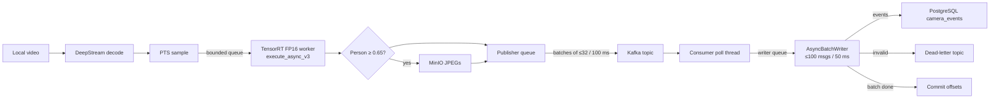

# DeepStream AI monitoring

One-camera reliability pipeline: DeepStream decodes a local video, TensorRT FP16 YOLO11n detects people on sampled frames, and every sample is published as a Protobuf result. Qualifying detections become events: two JPEGs in MinIO plus one PostgreSQL row. Decode, inference, Kafka publication, and database writes overlap through bounded queues and background batch workers.

## TensorRT and asynchronous batching

TensorRT is the inference runtime. The DeepStream container does not import PyTorch, Ultralytics, or OpenCV. `src/models/tensorrt_yolo11n_engine.py` loads `artifacts/models/yolo11n_fp16.engine`, binds CuPy GPU buffers, and runs `execute_async_v3` on a CUDA stream. Host-to-device copy and inference are timed with CUDA events. Each sampled frame is letterboxed to 640×640, inferred as a single engine input, then NMS-decoded on the host.

DeepStream and TensorRT overlap in time. The retriever walks DeepStream batch metadata, samples by presentation timestamp, clones only selected GPU frames, and enqueues them. A single TensorRT worker thread drains that queue. When the queue is full (`queues.model_input_capacity`, default 4, `overflow_policy: block`), capture waits. That is pipeline-level asynchronous batching: decode keeps running while the previous samples sit in the queue or execute on TensorRT.

Kafka is batched on both sides.

**Publish.** `AsyncProtobufKafkaPublisher` runs a background thread. The TensorRT worker serializes each `InferenceResult` and enqueues it. The publisher gathers up to `max_batch_messages` (32) or `batch_flush_interval_ms` (100 ms), then `produce`s the batch. The librdkafka producer adds a second batch layer (`linger.ms: 10`, `batch.size: 65536`, `compression.type: lz4`, `acks: all`, idempotent).

**Consume and persist.** `ResultsProcessingService` polls Kafka on its own thread with manual commits. Valid records go to `AsyncBatchWriter`, a background thread that never touches the consumer. It flushes when it reaches `batch_size` (100) or `flush_interval_ms` (50 ms). Events are inserted with `executemany` in `DatabaseBatchRepository`; invalid records go to the dead-letter topic as a batch. Offsets commit only after that batch completes. A full writer queue pauses the consumer until space returns.



At default settings a sampled frame becomes an event when at least one person has confidence **≥ 0.65**. Multiple people in one frame produce one event, with a box around each qualifying person. Both paths still publish one Kafka result per sample. The end-to-end supervisor starts the results processor and waits for Kafka assignment before starting the video.

## Project structure

| Path | Role |
|---|---|
| `configs/` | Typed settings. `config.yaml` holds TensorRT paths, queue depth, Kafka publisher batches, and consumer `batch_processing`. |
| `docker/`, `docker-compose.yml` | DeepStream 9.2 `dev` image (NVIDIA runtime), Kafka, MinIO. Postgres is the existing host/WSL instance. |
| `src/models/tensorrt_yolo11n_engine.py` | Load the FP16 engine, bind GPU memory, run TensorRT, decode detections. |
| `src/pipeline/run_tensorrt_event_pipeline.py` | DeepStream retrieve → PTS sampler → bounded frame queue → TensorRT worker → MinIO + async Kafka publish. |
| `src/pipeline/run_tensorrt_end_to_end.py` | Public launcher: unique session, start processor, wait for assignment, run producer, reconcile, shut down, write the report. |
| `src/pipeline/frame_sampler.py` | Select frames from presentation timestamps (fallback FPS if PTS is missing). |
| `src/results/async_protobuf_kafka_publisher.py` | Per-model background publisher; application-level Kafka batches. |
| `src/results/results_processing_service.py` | Poll, validate, submit to the writer, commit after completed batches. |
| `src/kafka/async_batch_writer.py` | Background PostgreSQL/DLT flushes; does not commit Kafka offsets. |
| `src/kafka/consumer.py` | Manual-commit consumer; pause/resume for writer backpressure. |
| `src/database/batch_result_repository.py` | Idempotent `INSERT` of event batches. |
| `src/storage/` | JPEG upload to MinIO and session image verification. |
| `schemas/`, `src/proto/` | `InferenceResult` Protobuf contract and generated bindings. |
| `infra/postgres/migrations/` | Camera registry, `camera_events`, explicit `event_bucket`. |
| `tools/` | Optional ONNX export and TensorRT engine build on the target GPU. |
| `artifacts/models/` | `yolo11n.pt`, ONNX, and `yolo11n_fp16.engine`. |
| `artifacts/results/`, `artifacts/benchmarks/` | Per-session JSONL, producer metrics, processor counters, end-to-end report. |
| `videos/reliability/` | Input clips, including `paris_city_walk.mp4`. |

## One-time setup for the existing WSL project

Run commands from the project root. The application uses the existing PostgreSQL container and provisions MinIO through Compose. On a fresh checkout, copy `.env.example` to `.env` and set the application database connection. In an existing checkout, keep the current `.env`.

```bash
grep -q '^OBJECT_STORE_PASSWORD=.' .env || printf '\nOBJECT_STORE_PASSWORD=%s\n' "$(openssl rand -hex 32)" >> .env
docker compose build object-store
docker compose up -d --wait kafka object-store
```

If you also need to rebuild the DeepStream image, run `docker compose build dev object-store` instead of `object-store` alone. The first object-store build compiles the pinned upstream MinIO release and needs Docker Hub, GitHub, and Go module access.

Apply the additive migrations as the database owner. These commands use `POSTGRES_USER` inside the existing Paris Postgres container (that image often has no `postgres` role). Each migration is safe to re-run.

```bash
docker exec -i postgres-postgres-1 sh -c 'exec psql -v ON_ERROR_STOP=1 -U "${POSTGRES_USER}" -d ai_monitoring' \
  < infra/postgres/migrations/004_camera_events.sql &&
docker exec -i postgres-postgres-1 sh -c 'exec psql -v ON_ERROR_STOP=1 -U "${POSTGRES_USER}" -d ai_monitoring' \
  < infra/postgres/migrations/005_event_bucket.sql &&
docker exec postgres-postgres-1 sh -c 'exec psql -v ON_ERROR_STOP=1 -U "${POSTGRES_USER}" -d ai_monitoring -c "GRANT SELECT ON cameras TO ai_app; GRANT SELECT, INSERT ON camera_events TO ai_app;"'
```

The registry seeds `camera-01` in zone `A`, with model names `fire` and `person`. The active model is `person`. Fire is a registry label only. The runner reads the camera's storage root from PostgreSQL and creates the bucket on first use. Compose keeps MinIO data in the named `camera_objects` volume.

## Run the Paris walk

From the project root in WSL. Defaults sample the 1920 × 1080, 60 FPS Paris clip at 8 FPS.

| Prerequisite | What the runner expects |
|---|---|
| Input video | `videos/reliability/paris_city_walk.mp4` |
| GPU and engine | Compose NVIDIA GPU access and a compatible `artifacts/models/yolo11n_fp16.engine` |
| Database | Project `.env` with application credentials. Migrations 004 and 005 applied. |

```bash
docker compose up -d --wait kafka object-store
docker compose run --rm -T dev python3 -u -m src.pipeline.run_tensorrt_end_to_end \
  --source /workspace/videos/reliability/paris_city_walk.mp4 \
  --camera-id camera-01 --sample-fps 8 --verification-timeout 600
```

A zero exit code and the final PASS confirm a completed run. For a different clip, set `--batch-width` and `--batch-height` to its dimensions (DeepStream muxer size, not TensorRT batch size). Sampling uses presentation timestamps. Set `--fallback-source-fps` to the source frame rate when timestamps are missing. Omit `--max-samples` for full coverage. Compare the report's decoded count with the source video frame count. Each invocation generates a new session ID. Do not pass `--no-kafka-verify`; the end-to-end runner requires Kafka verification.

If the local engine needs rebuilding, place YOLO11n weights in `artifacts/models/yolo11n.pt`, run `python -m tools.export_yolo11n_onnx` in an environment with `requirements-yolo.txt`, then run `docker compose run --rm --no-deps dev python3 -m tools.build_yolo11n_tensorrt_engine` on the target GPU. A compatible existing engine skips these steps.

## Inspect PostgreSQL

SQL must run inside `psql`, not the WSL shell. Connect as the container owner:

```bash
docker exec -it postgres-postgres-1 sh -c 'exec psql -U "${POSTGRES_USER}" -d ai_monitoring'
```

When the prompt is `ai_monitoring=#`:

```sql
SELECT camera_id, zone, available_models, current_model, event_bucket, event_storage_root
FROM cameras;

SELECT e.event_at, e.source_video_ms, e.camera_id, c.zone, e.model_id,
       e.event_type, e.event_bucket, e.clean_key, e.boxed_key
FROM camera_events AS e
JOIN cameras AS c USING (camera_id)
ORDER BY e.event_at DESC
LIMIT 10;
```

For one end-to-end run, use the session ID printed by the launcher:

```sql
SELECT source_session_id, frame_sequence, event_at, source_video_ms,
       event_type, clean_key, boxed_key, detections
FROM camera_events
WHERE source_session_id = '<session-id>'
ORDER BY frame_sequence;
```

Leave with `\q`. One-shot from bash:

```bash
docker exec -i postgres-postgres-1 sh -c 'exec psql -U "${POSTGRES_USER}" -d ai_monitoring' <<'SQL'
SELECT source_session_id, COUNT(*) AS event_rows
FROM camera_events
GROUP BY source_session_id
ORDER BY MAX(event_at) DESC;
SQL
```

`event_at` is UTC wall-clock time at frame retrieval (`timestamptz`, millisecond precision). `source_video_ms` is the playback position in the clip. Replaying the clip creates a new session and new observation timestamps.

## View event frames in MinIO

Frames are JPEG objects, not database blobs. Postgres stores `event_bucket`, `clean_key`, and `boxed_key`.

Open the [local MinIO console](http://localhost:9001). Sign in as `camera-store` with `OBJECT_STORE_PASSWORD` from `.env`. Open bucket `camera-events` and browse to `events/camera-01/<session>/`. Each event has exactly two JPEGs. New runs write no per-event JSON sidecar.

| Output | Contents |
|---|---|
| `<frame-sequence>.jpg` | Clean event frame at the configured batch resolution |
| `<frame-sequence>.boxed.jpg` | Matching frame with boxes around qualifying people |
| `artifacts/results/yolo11n-person/<session>/results.jsonl` | One line per sampled frame |
| `artifacts/results/yolo11n-person/<session>/performance.json` | Producer counts, TensorRT timings, publisher counters |
| `artifacts/benchmarks/processor_<session>.json` | Consumer and PostgreSQL writer batch counters |
| `artifacts/benchmarks/tensorrt_end_to_end_<session>.json` | Stage throughput, verified rows and unique images |

The object URI is `s3://` + `event_bucket` + `/` + `clean_key` or `boxed_key`.

## Interpreting throughput

Every measurement includes a count, seconds, unit, and timing window. Average throughput is completed items divided by measured seconds. Stages overlap: the bounded TensorRT input queue can slow capture while inference or disk I/O catches up. Kafka publisher and PostgreSQL writer metrics are batch-oriented.

| Stage | Unit and timing interval |
|---|---|
| DeepStream decode and sampling | Decoded frames/s and selected samples/s over capture-to-EOS wall time, including queue backpressure |
| Preprocessing | Samples/s over host copy and letterbox |
| Host-to-device transfer and TensorRT | Separate samples/s over CUDA event times for `set()` and `execute_async_v3` |
| Postprocessing | Samples/s over NMS decode |
| Result manifest | Sample records/s over JSONL appends |
| Event storage | Events/s over encoding and uploading both JPEGs |
| Kafka delivery | Acknowledged messages/s from flow start through producer drain (application batches + librdkafka batches) |
| Kafka verification | Verified messages/s during independent replay, including JPEG checks |
| Consumer validation | Messages/s over deserialize and validate |
| PostgreSQL writes | Persisted rows/s over batched `executemany`, including retries |
| End to end | Verified samples/s from processor launch through verification and shutdown |

Use the end-to-end rate to compare runs with the same source, sampling policy, and storage location. The 8 FPS setting uses the video clock. Reported throughput uses processing time. Consumer and writer metrics cover that processor instance, so use a quiet result topic for isolated measurements.

`--verification-timeout` controls the Kafka and object verification pass. `--db-timeout` controls the wait for consumer offsets and PostgreSQL convergence.
