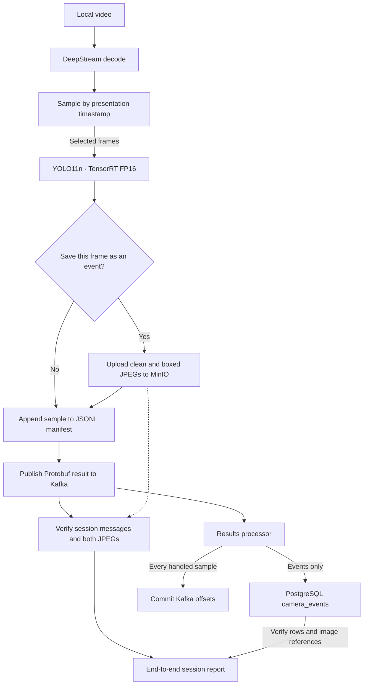

# DeepStream end-to-end reliability test

Run one local video from its first frame to end of stream. DeepStream samples decoded frames, YOLO11n identifies people, and each sampled frame produces one Kafka message. Each qualifying event creates one PostgreSQL row and two JPEG objects in the local MinIO bucket. A session report reconciles these outputs and measures throughput at each stage.

## Pipeline block diagram



At the default settings, a sampled frame becomes an event when at least one person has confidence **≥ 0.65**. Multiple people in one frame produce one event, with a box around each qualifying person. Both paths through the decision produce one result for the sample. The supervisor starts the results consumer and waits for its Kafka assignment before starting the video.

## One-time setup for the existing WSL project

Run the commands from the project root. The application uses the existing PostgreSQL container and provisions MinIO through Compose. On a fresh checkout, first copy `.env.example` to `.env` and configure the application database connection. In an existing checkout, keep the current `.env`.

```bash
grep -q '^OBJECT_STORE_PASSWORD=.' .env || printf '\nOBJECT_STORE_PASSWORD=%s\n' "$(openssl rand -hex 32)" >> .env
docker compose build dev object-store
docker compose up -d --wait kafka object-store
```

If the DeepStream image is already built, run `docker compose build object-store` followed by `docker compose up -d --wait kafka object-store`. The first object-store build compiles the pinned upstream MinIO release and requires access to Docker Hub, GitHub and Go module dependencies.

Apply the additive migration using the database owner. These commands assume the existing container name, database and application role from the Paris setup. The migration is safe to run more than once and keeps earlier inference rows and files.

```bash
docker exec -i postgres-postgres-1 sh -c 'exec psql -v ON_ERROR_STOP=1 -U "${POSTGRES_USER:-postgres}" -d ai_monitoring' \
  < infra/postgres/migrations/004_camera_events.sql &&
docker exec postgres-postgres-1 sh -c 'exec psql -v ON_ERROR_STOP=1 -U "${POSTGRES_USER:-postgres}" -d ai_monitoring -c "GRANT SELECT ON cameras TO ai_app; GRANT SELECT, INSERT ON camera_events TO ai_app;"'
```

The registry seeds `camera-01` in zone `A`, with model names `fire` and `person`. The active model is `person`. Fire is a registry label only. The runner reads the camera's storage root from PostgreSQL and creates the bucket on first use. Compose keeps MinIO data in the named `camera_objects` volume across container restarts.

## Run the Paris walk

Run these commands from the project root in WSL. The defaults sample the 1920 × 1080, 60 FPS Paris clip at 8 FPS.

| Prerequisite | What the runner expects |
|---|---|
| Input video | `videos/reliability/paris_city_walk.mp4` |
| GPU and engine | Docker Compose with NVIDIA GPU access and a compatible `artifacts/models/yolo11n_fp16.engine` |
| Database | A project `.env` with the application credentials for the external PostgreSQL instance. Apply migration 004 to create the camera registry and event table. |

```bash
docker compose up -d --wait kafka object-store
docker compose run --rm -T dev python3 -u -m src.pipeline.run_tensorrt_end_to_end \
  --source /workspace/videos/reliability/paris_city_walk.mp4 \
  --camera-id camera-01 --sample-fps 8 --verification-timeout 600
```

A zero exit code and the final PASS confirm a completed run. For a different clip, set `--batch-width` and `--batch-height` to its dimensions. Sampling uses presentation timestamps. Set `--fallback-source-fps` to the source frame rate for frames with missing timestamps. Omit `--max-samples` for full coverage. Compare the report's decoded count with the source video frame count. Each invocation generates a new session ID.

If the local engine needs rebuilding, place YOLO11n weights in `artifacts/models/yolo11n.pt`, run `python -m tools.export_yolo11n_onnx` in a Python environment with `requirements-yolo.txt` installed, then run `docker compose run --rm --no-deps dev python3 -m tools.build_yolo11n_tensorrt_engine` on the target GPU. A compatible existing engine skips these preparation steps.

## Find the images and reports

Open the [local MinIO console](http://localhost:9001) and sign in as `camera-store` with `OBJECT_STORE_PASSWORD` from the project `.env`. Open bucket `camera-events` and browse to `events/camera-01/<session>/`. Each event has exactly two JPEGs. New runs write no per-event JSON sidecar.

| Output | Contents |
|---|---|
| `<frame-sequence>.jpg` in MinIO | Clean event frame at the configured batch resolution |
| `<frame-sequence>.boxed.jpg` in the same prefix | Matching frame with boxes around qualifying people |
| `artifacts/results/yolo11n-person/<session>/results.jsonl` | One line per sampled frame, including source frame sequence, number of qualifying detections, event flag and image key |
| `artifacts/results/yolo11n-person/<session>/performance.json` | Producer counts, throughput, publisher counters and verifier diagnostics |
| `artifacts/benchmarks/processor_<session>.json` | Drained Kafka consumer and PostgreSQL writer counters |
| `artifacts/benchmarks/tensorrt_end_to_end_<session>.json` | Final frame counts, stage throughput, verified database rows and unique images |

Use the session ID printed by the launcher to match objects, reports and event rows. Each event has two clocks. Python's `time.time_ns()` records the UTC wall-clock observation time at frame retrieval, stored as PostgreSQL `event_at` (`timestamptz`, millisecond precision). `source_video_ms` is the playback position in the source clip. Replaying the clip creates a new session and new observation timestamps.

```sql
SELECT camera_id, zone, available_models, current_model, event_storage_root
FROM cameras;

SELECT e.event_at, e.source_video_ms, e.camera_id, c.zone, e.model_id,
       e.event_type, e.clean_key, e.boxed_key
FROM camera_events AS e
JOIN cameras AS c USING (camera_id)
ORDER BY e.event_at DESC
LIMIT 10;
```

### Read the frame counts

| Report fields | How to interpret them |
|---|---|
| `decoded`, `sampled`, `skipped` | For a full run, decoded frames should equal sampled plus skipped. Compare decoded with the source frame count to check video coverage. |
| `qualifying`, `event_frames` | Qualifying counts samples that meet the detection threshold. Event frames also satisfy the storage policy. By default, every qualifying sample is saved. |
| `images_written`, `images_reused` | Clean JPEGs written or reused for this session. |
| `boxed_images_written`, `boxed_images_reused` | Corresponding boxed JPEGs written or reused. Each event has one JPEG of each kind. |
| `verified_images` | Verified JPEG pairs referenced by event rows. The PostgreSQL report also gives the individual object count. |

## Interpreting throughput

Every measurement includes a count, seconds, unit and timing window. Average throughput is total completed items divided by total measured seconds. A zero-length window yields a null rate. Stages overlap, and the bounded input queue can slow capture while inference or disk I/O catches up.

| Stage | Unit and timing interval |
|---|---|
| DeepStream decode and sampling | Decoded frames/s and selected samples/s over the same capture-to-EOS wall time, including backpressure |
| Preprocessing | Samples/s over summed preparation time, including copying the selected GPU frame to the host and letterboxing |
| Host-to-device transfer and TensorRT | Separate samples/s over the respective summed CUDA event times |
| Postprocessing | Samples/s over summed output processing time |
| Result manifest | Sample records/s over JSONL append calls |
| Event storage | Events/s over encoding and uploading both JPEGs, including any reuse |
| Kafka delivery | Acknowledged messages/s from flow start through producer drain |
| Kafka verification | Verified messages/s during independent replay, including both JPEG integrity checks |
| Consumer validation | Messages/s over deserialization and validation in the results processor |
| PostgreSQL writes | Persisted rows/s over summed batch persistence time, including retries |
| End to end | Verified samples/s from processor launch through database/image verification and clean shutdown |

Use the end-to-end rate to compare runs with the same source, sampling policy and storage location. The 8 FPS setting uses the video clock. Reported throughput uses processing time. The consumer and writer metrics cover their processor instance, so use a quiet result topic for isolated measurements.

## Structure and design decisions

| Location | Responsibility |
|---|---|
| `configs/`, `docker/`, `docker-compose.yml` | Typed settings, DeepStream 9.2 container, NVIDIA runtime and Kafka broker |
| `src/pipeline/run_tensorrt_end_to_end.py` | Public launcher. Creates a fresh session and Kafka group, waits for assignment, runs the producer, reconciles results, shuts down the processor and writes the report |
| `src/pipeline/`, `src/models/` | DeepStream Service Maker and CuPy retrieve frames. A PTS sampler selects frames before cloning GPU memory. A bounded queue hands selected frames to one TensorRT FP16 worker and applies backpressure |
| `src/storage/` | Pillow encodes event JPEGs. Conditional object writes and camera/session/sequence keys make repeated uploads idempotent |
| `schemas/`, `src/proto/`, `src/results/` | Protobuf contract and generated bindings, async publisher and consumer lifecycle. Every sampled frame carries a result, including those with no event |
| `src/kafka/`, `src/database/` | Kafka validation, batched psycopg writes, dead-letter handling and offset commits following completed batches |
| `infra/postgres/`, `tools/` | Metadata migration for the provisioned database and optional ONNX export / TensorRT engine preparation |

The independent verifier checks the session's Kafka sequences, event flags and referenced files. The supervisor checks PostgreSQL result and event counts and verifies unique JPEG hashes. If the producer fails acceptance, inspect `failed_acceptance_checks` in its `performance.json` and process exit code. `--verification-timeout` controls the Kafka and object verification pass. `--db-timeout` separately controls the wait for consumer offsets and PostgreSQL convergence.
