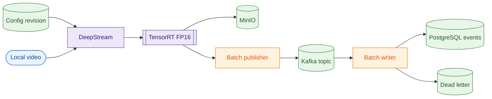

# DeepStream AI monitoring

One-camera reliability pipeline: DeepStream decodes a local video, TensorRT FP16 YOLO11n detects people on sampled frames, and every sample is published as a Protobuf result. Qualifying detections become events: two JPEGs in MinIO plus one PostgreSQL row. Decode, inference, Kafka publication, and database writes overlap through bounded queues and background batch workers.

## TensorRT and asynchronous batching

TensorRT is the inference runtime. The DeepStream container does not import PyTorch, Ultralytics, or OpenCV. `src/models/tensorrt_yolo11n_engine.py` loads `artifacts/models/yolo11n_fp16.engine`, binds CuPy GPU buffers, and runs `execute_async_v3` on a CUDA stream. Host-to-device copy and inference are timed with CUDA events. Each sampled frame is letterboxed to 640×640, inferred as a single engine input, then NMS-decoded on the host.

DeepStream and TensorRT overlap in time. The retriever walks DeepStream batch metadata, samples by presentation timestamp, clones only selected GPU frames, and enqueues them. A single TensorRT worker thread drains that queue. When the queue is full (`queues.model_input_capacity`, default 4, `overflow_policy: block`), capture waits. That is pipeline-level asynchronous batching: decode keeps running while the previous samples sit in the queue or execute on TensorRT.

Kafka is batched on both sides.

**Publish.** `AsyncProtobufKafkaPublisher` runs a background thread. The TensorRT worker serializes each `InferenceResult` and enqueues it. The publisher gathers up to `max_batch_messages` (32) or `batch_flush_interval_ms` (100 ms), then `produce`s the batch. The librdkafka producer adds a second batch layer (`linger.ms: 10`, `batch.size: 65536`, `compression.type: lz4`, `acks: all`, idempotent).

**Consume and persist.** `ResultsProcessingService` polls Kafka on its own thread with manual commits. Valid records go to `AsyncBatchWriter`, a background thread that never touches the consumer. It flushes when it reaches `batch_size` (100) or `flush_interval_ms` (50 ms). Events are inserted with `executemany` in `DatabaseBatchRepository`; invalid records go to the dead-letter topic as a batch. Offsets commit only after that batch completes. A full writer queue pauses the consumer until space returns.



The session reads one camera configuration revision from PostgreSQL before the first frame is decoded and copies that revision onto every sampled frame before the frame enters the inference queue. Kafka carries `camera_id` and `camera_config_version` with the model, session, frame sequence, timestamps, detections, and event object keys. A qualifying frame also carries `event` (the model class, `person`), `confidence` of the strongest qualifying person, and `person_id`. `person_id` is `<frame sequence>:<number>`, and number 1 is the highest confidence in that frame. The model does not follow a person into the next frame. Every person in the frame is also listed in `detections` with that person's own `person_id` and `confidence`. PostgreSQL stores the same three values on `camera_events`. Messages from an older producer leave them empty, and the consumer stores NULL. It does not carry credentials, connection settings, or the rest of the camera registry. PostgreSQL stores the revision on `camera_events` and the immutable snapshot in `camera_config_revisions`. A message encoded before field 29 existed has `camera_config_version = 0`; the consumer stores that event with a NULL revision instead of assigning the current configuration. Editing `infra/postgres/cameras_counfig/camera-01.yaml` does not change a session that has already started. The next session loads the latest applied revision. There is no hot reload and no configuration topic.

At default settings a sampled frame becomes an event when at least one person has confidence **≥ 0.65**. Multiple people in one frame produce one event, with a box around each qualifying person. Both paths still publish one Kafka result per sample. The end-to-end supervisor starts the results processor and waits for Kafka assignment before starting the video.

## Project structure

| Path | Role |
|---|---|
| `configs/` | Typed settings. `config.yaml` holds TensorRT paths, queue depth, Kafka publisher batches, and consumer `batch_processing`. |
| `docker/`, `docker-compose.yml` | DeepStream 9.2 `dev` image (NVIDIA runtime), Kafka, MinIO. Postgres is the existing host/WSL instance. |
| `src/models/tensorrt_yolo11n_engine.py` | Load the FP16 engine, bind GPU memory, run TensorRT, decode detections. |
| `src/pipeline/run_tensorrt_event_pipeline.py` | DeepStream retrieve → PTS sampler → bounded frame queue → TensorRT worker → MinIO + async Kafka publish. |
| `src/pipeline/run_tensorrt_end_to_end.py` | Public launcher: unique session, start processor, wait for assignment, run producer, reconcile, shut down, write the report. |
| `src/pipeline/frame_sampler.py` | Select frames from presentation timestamps (fallback FPS if PTS is missing). |
| `src/results/async_protobuf_kafka_publisher.py` | Per-model background publisher; application-level Kafka batches. |
| `src/results/results_processing_service.py` | Poll, validate, submit to the writer, commit after completed batches. |
| `src/kafka/async_batch_writer.py` | Background PostgreSQL/DLT flushes; does not commit Kafka offsets. |
| `src/kafka/consumer.py` | Manual-commit consumer; pause/resume for writer backpressure. |
| `src/database/batch_result_repository.py` | Idempotent `INSERT` of event batches. |
| `src/storage/` | JPEG upload to MinIO and session image verification. |
| `schemas/`, `src/proto/` | `InferenceResult` Protobuf contract and generated bindings. |
| `infra/postgres/migrations/` | Camera registry, `camera_events`, explicit `event_bucket`, immutable configuration revisions. |
| `infra/postgres/cameras_counfig/` | Desired camera configuration. `camera-01.yaml` is applied into PostgreSQL; it is not read by a running session. |
| `tools/` | Optional ONNX export and TensorRT engine build on the target GPU. |
| `artifacts/models/` | `yolo11n.pt`, ONNX, and `yolo11n_fp16.engine`. |
| `artifacts/results/`, `artifacts/benchmarks/` | Per-session JSONL, producer metrics, processor counters, end-to-end report. |
| `videos/reliability/` | Input clips, including `paris_city_walk.mp4`. |

## One-time setup for the existing WSL project

Run commands from the project root. The application uses the existing PostgreSQL container and provisions MinIO through Compose. On a fresh checkout, copy `.env.example` to `.env` and set the application database connection. In an existing checkout, keep the current `.env`.

```bash
grep -q '^OBJECT_STORE_PASSWORD=.' .env || printf '\nOBJECT_STORE_PASSWORD=%s\n' "$(openssl rand -hex 32)" >> .env
docker compose build object-store
docker compose up -d --wait kafka object-store
```

If you also need to rebuild the DeepStream image, run `docker compose build dev object-store` instead of `object-store` alone. The first object-store build compiles the pinned upstream MinIO release and needs Docker Hub, GitHub, and Go module access.

Apply the additive migrations as the database owner. These commands use `POSTGRES_USER` inside the existing Paris Postgres container (that image often has no `postgres` role). Each migration is safe to re-run.

```bash
docker exec -i postgres-postgres-1 sh -c 'exec psql -v ON_ERROR_STOP=1 -U "${POSTGRES_USER}" -d ai_monitoring' \
  < infra/postgres/migrations/004_camera_events.sql &&
docker exec -i postgres-postgres-1 sh -c 'exec psql -v ON_ERROR_STOP=1 -U "${POSTGRES_USER}" -d ai_monitoring' \
  < infra/postgres/migrations/005_event_bucket.sql &&
docker exec postgres-postgres-1 sh -c 'exec psql -v ON_ERROR_STOP=1 -U "${POSTGRES_USER}" -d ai_monitoring -c "GRANT SELECT ON cameras TO ai_app; GRANT SELECT, INSERT ON camera_events TO ai_app;"' &&
docker exec -i postgres-postgres-1 sh -c 'exec psql -v ON_ERROR_STOP=1 -U "${POSTGRES_USER}" -d ai_monitoring' \
  < infra/postgres/migrations/006_camera_config_revisions.sql &&
docker exec -i postgres-postgres-1 sh -c 'exec psql -v ON_ERROR_STOP=1 -U "${POSTGRES_USER}" -d ai_monitoring' \
  < infra/postgres/migrations/007_event_observation.sql
```

Migration 006 seeds revision 1 from each camera's existing zone, models, and storage root. It leaves `region` unset when the camera has no region, and it leaves existing events unversioned. The checked-in migrations do not define `camera_model_assignments`. If that table is already present and has `camera_id`, revision 1 snapshots its rows before the revision becomes immutable.

Validate and apply the desired camera file with the application database credentials from `.env`. The file has no credentials. Applying these values again keeps the same revision number. A real change inserts the next revision and updates the camera's current revision in one transaction. Names, connection settings, and credentials already stored for the camera are left as they are.

```bash
docker compose run --rm --no-deps -T dev python3 -m tools.apply_camera_config infra/postgres/cameras_counfig/camera-01.yaml
```

The registry seeds `camera-01` in zone `A`, with model names `fire` and `person`. The active model is `person`. Fire is a registry label only. Region is unset. The runner reads the applied revision's storage root from PostgreSQL and creates the bucket on first use. Compose keeps MinIO data in the named `camera_objects` volume.

## Run the first 500 source frames

`--max-samples` limits inference samples and still decodes the input through end of stream. The bounded check uses a 500-frame clip instead. At 60 FPS and 8 FPS sampling, that clip produces roughly 67 sampled results; use the report counters rather than that estimate. Apply `camera-01.yaml` first. The printed `config_version` must match `camera_config_version` on the Kafka results and `camera_events.config_version` for every event from the session.

```bash
ffmpeg -y -i videos/reliability/paris_city_walk.mp4 -frames:v 500 -an \
  -c:v libx264 -pix_fmt yuv420p videos/reliability/paris_first_500_frames.mp4
ffprobe -v error -select_streams v:0 -count_frames \
  -show_entries stream=nb_read_frames -of csv=p=0 \
  videos/reliability/paris_first_500_frames.mp4
docker compose run --rm --no-deps -T dev python3 -m tools.apply_camera_config infra/postgres/cameras_counfig/camera-01.yaml
docker compose up -d --wait kafka object-store
docker compose run --rm -T dev python3 -u -m src.pipeline.run_tensorrt_end_to_end \
  --source /workspace/videos/reliability/paris_first_500_frames.mp4 \
  --camera-id camera-01 --sample-fps 8 --verification-timeout 600
```

`ffprobe` should print `500`. The clip matches `*.mp4` in `.gitignore` and stays untracked. Kafka results must equal sampled frames. PostgreSQL rows must equal qualifying stored events. Each event has one clean JPEG and one boxed JPEG.

Join an event back to the revision that applied to its frame:

```sql
SELECT e.event_at, e.camera_id, e.config_version, r.zone, r.region,
       r.available_models, r.active_models, r.event_storage_root
FROM camera_events AS e
JOIN camera_config_revisions AS r
  ON r.camera_id = e.camera_id
 AND r.config_version = e.config_version
ORDER BY e.event_at DESC
LIMIT 10;
```

Events with `config_version` NULL were stored before a revision could be proven. They are not backfilled with the current zone.

## Run the full Paris walk

From the project root in WSL. Defaults sample the full 1920 × 1080, 60 FPS Paris clip at 8 FPS. Start this only after reviewing the 500-frame result.

| Prerequisite | What the runner expects |
|---|---|
| Input video | `videos/reliability/paris_city_walk.mp4` |
| GPU and engine | Compose NVIDIA GPU access and a compatible `artifacts/models/yolo11n_fp16.engine` |
| Database | Project `.env` with application credentials. Migrations 004, 005, and 006 applied, then `camera-01.yaml` applied. |

```bash
docker compose up -d --wait kafka object-store
docker compose run --rm -T dev python3 -u -m src.pipeline.run_tensorrt_end_to_end \
  --source /workspace/videos/reliability/paris_city_walk.mp4 \
  --camera-id camera-01 --sample-fps 8 --verification-timeout 600
```

A zero exit code and the final PASS confirm a completed run. For a different clip, set `--batch-width` and `--batch-height` to its dimensions (DeepStream muxer size, not TensorRT batch size). Sampling uses presentation timestamps. Set `--fallback-source-fps` to the source frame rate when timestamps are missing. Omit `--max-samples` for full coverage. Compare the report's decoded count with the source video frame count. Each invocation generates a new session ID. Do not pass `--no-kafka-verify`; the end-to-end runner requires Kafka verification.

If the local engine needs rebuilding, place YOLO11n weights in `artifacts/models/yolo11n.pt`, run `python -m tools.export_yolo11n_onnx` in an environment with `requirements-yolo.txt`, then run `docker compose run --rm --no-deps dev python3 -m tools.build_yolo11n_tensorrt_engine` on the target GPU. A compatible existing engine skips these steps.

## Inspect PostgreSQL

SQL must run inside `psql`, not the WSL shell. Connect as the container owner:

```bash
docker exec -it postgres-postgres-1 sh -c 'exec psql -U "${POSTGRES_USER}" -d ai_monitoring'
```

When the prompt is `ai_monitoring=#`:

```sql
SELECT camera_id, zone, region, current_config_version, available_models,
       current_model, event_bucket, event_storage_root
FROM cameras;

SELECT e.event_at, e.camera_id, e.event, e.confidence, e.person_id,
       e.config_version, r.zone, e.event_bucket, e.clean_key, e.boxed_key
FROM camera_events AS e
LEFT JOIN camera_config_revisions AS r
  ON r.camera_id = e.camera_id
 AND r.config_version = e.config_version
ORDER BY e.event_at DESC
LIMIT 10;
```

For one end-to-end run, use the session ID printed by the launcher:

```sql
SELECT source_session_id, frame_sequence, event_at, source_video_ms,
       event_type, event_bucket, clean_key, boxed_key, detections
FROM camera_events
WHERE source_session_id = '<session-id>'
ORDER BY frame_sequence;
```

Leave with `\q`. One-shot from bash:

```bash
docker exec -i postgres-postgres-1 sh -c 'exec psql -U "${POSTGRES_USER}" -d ai_monitoring' <<'SQL'
SELECT source_session_id, event_bucket, COUNT(*) AS event_rows
FROM camera_events
GROUP BY source_session_id, event_bucket
ORDER BY MAX(event_at) DESC;
SQL
```

`event_at` is UTC wall-clock time at frame retrieval (`timestamptz`, millisecond precision). `source_video_ms` is the playback position in the clip. Replaying the clip creates a new session and new observation timestamps.

## View event frames in MinIO

Frames are JPEG objects, not database blobs. Postgres stores `event_bucket`, `clean_key`, and `boxed_key`.

Open the [local MinIO console](http://localhost:9001). Sign in as `camera-store` with `OBJECT_STORE_PASSWORD` from `.env`. Open bucket `camera-events` and browse to `events/camera-01/<session>/`. Each event has exactly two JPEGs. New runs write no per-event JSON sidecar.

| Output | Contents |
|---|---|
| `<frame-sequence>.jpg` | Clean event frame at the configured batch resolution |
| `<frame-sequence>.boxed.jpg` | Matching frame with boxes around qualifying people |
| `artifacts/results/yolo11n-person/<session>/results.jsonl` | One line per sampled frame |
| `artifacts/results/yolo11n-person/<session>/performance.json` | Producer counts, TensorRT timings, publisher counters |
| `artifacts/benchmarks/processor_<session>.json` | Consumer and PostgreSQL writer batch counters |
| `artifacts/benchmarks/tensorrt_end_to_end_<session>.json` | Stage throughput, verified rows and unique images |

The object URI is `s3://` + `event_bucket` + `/` + `clean_key` or `boxed_key`.

## Event JPEG storage

Each qualifying event still stores exactly two full-resolution JPEGs at quality 88 with 4:4:4 subsampling, plus one PostgreSQL row. Pillow in this environment already uses libjpeg-turbo. A second encoder and a switch to 4:2:0 subsampling were set aside: 4:2:0 changes chroma quality, and the bytes of the current encoder are unchanged by the path below.

The baseline copied the 1920×1080 frame twice, encoded the clean JPEG, encoded the boxed JPEG, and uploaded those objects one after the other. On 80 representative event frames, interleaved against the live MinIO bucket and repeated, that pair took about 42 ms. The time split into roughly 5.7 ms of copies, 7.0 ms to encode the clean JPEG, 0.06 ms to draw the boxes, 7.1 ms to encode the boxed JPEG, 0.4 ms to hash both payloads, and about 11 ms for each upload.

`EventFrameStore.put_pair` keeps one frame copy. It encodes the clean JPEG, draws the boxes on that image, encodes the boxed JPEG, then uploads the two objects at the same time through one S3 client and a pool of two threads. The call returns only after both uploads are acknowledged, which is when the Kafka result may be published. A failed upload leaves the successful object in place. The retry uses `IfNoneMatch` and checks the stored SHA-256, so the pair completes without publishing a partial event. Pool queue wait on the benchmark was under 1 ms. The drain time is the overlapping upload window and stays inside the measured pair interval.

Uploading both objects after both buffers exist was as fast as starting the clean upload during the boxed encode, and it was faster than a second S3 client. That is the path the pipeline uses.

Compare the candidates on the same machine and MinIO instance:

```bash
PYTHONPATH=. python tools/benchmark_event_jpeg_storage.py --frames 80 --warmup 5
```

Repeat the full Paris walk at 8 FPS:

```bash
docker compose up -d --wait kafka object-store
docker compose run --rm -T dev python3 -u -m src.pipeline.run_tensorrt_end_to_end \
  --source /workspace/videos/reliability/paris_city_walk.mp4 \
  --camera-id camera-01 --sample-fps 8 --verification-timeout 600
```

The pair latency mean, p50, p95, and per-stage means are in the producer report under `event_image_store_stats`.

## See the throughput

A finished run prints `COMPLETE TENSORRT END-TO-END PIPELINE REPORT` with one line per stage. The same numbers are stored in `artifacts/benchmarks/tensorrt_end_to_end_<session>.json` under `throughput`. The filename is the session id. Each stage has `per_second`, `count`, `seconds`, `unit`, and `window`. `per_second` is `count / seconds`. A zero-length window is `null`.

The console log is not required. From the project root, read the newest report:

```bash
jq '.source_session_id, .throughput' "$(ls -t artifacts/benchmarks/tensorrt_end_to_end_*.json | head -1)"
```

### Measured rates

Paris walk, session `848193b7f0074ccb93cc2085ebe4201f`, 1920×1080 at 8 FPS. **End-to-end throughput is 21.22 verified samples/s** over 459.7 seconds (9,756 samples).

| Stage | Throughput | Work | Time |
|---|---:|---:|---:|
| DeepStream decode | 177.03 frames/s | 73,169 frames | 413.3 s |
| Sampling | 23.60 samples/s | 9,756 samples | 413.3 s |
| Preprocess | 73.44 samples/s | 9,756 samples | 132.9 s |
| Host-to-device copy | 1,263.94 samples/s | 9,756 samples | 7.7 s |
| TensorRT | 198.87 samples/s | 9,756 samples | 49.1 s |
| Postprocess | 579.67 samples/s | 9,756 samples | 16.8 s |
| Result manifest | 185.71 samples/s | 9,756 samples | 52.5 s |
| Event storage | 24.21 events/s | 3,573 events | 147.6 s |
| Kafka delivery | 23.60 messages/s | 9,756 messages | 413.4 s |
| Kafka verification | 430.91 messages/s | 9,756 messages | 22.6 s |
| Consumer validation | 10,910.22 messages/s | 9,756 messages | 0.9 s |
| PostgreSQL writes | 81.19 rows/s | 3,573 rows | 44.0 s |
| End to end | 21.22 verified samples/s | 9,756 samples | 459.7 s |

## Interpreting throughput

Every measurement includes a count, seconds, unit, and timing window. Average throughput is completed items divided by measured seconds. Stages overlap: the bounded TensorRT input queue can slow capture while inference or disk I/O catches up. Kafka publisher and PostgreSQL writer metrics are batch-oriented.

| Stage | Unit and timing interval |
|---|---|
| DeepStream decode and sampling | Decoded frames/s and selected samples/s over capture-to-EOS wall time, including queue backpressure |
| Preprocessing | Samples/s over host copy and letterbox |
| Host-to-device transfer and TensorRT | Separate samples/s over CUDA event times for `set()` and `execute_async_v3` |
| Postprocessing | Samples/s over NMS decode |
| Result manifest | Sample records/s over JSONL appends |
| Event storage | Events/s over encoding and uploading both JPEGs |
| Kafka delivery | Acknowledged messages/s from flow start through producer drain (application batches + librdkafka batches) |
| Kafka verification | Verified messages/s during independent replay, including JPEG checks |
| Consumer validation | Messages/s over deserialize and validate |
| PostgreSQL writes | Persisted rows/s over batched `executemany`, including retries |
| End to end | Verified samples/s from processor launch through verification and shutdown |

Use the end-to-end rate to compare runs with the same source, sampling policy, and storage location. The 8 FPS setting uses the video clock. Reported throughput uses processing time. Consumer and writer metrics cover that processor instance, so use a quiet result topic for isolated measurements.

`--verification-timeout` controls the Kafka and object verification pass. `--db-timeout` controls the wait for consumer offsets and PostgreSQL convergence.
